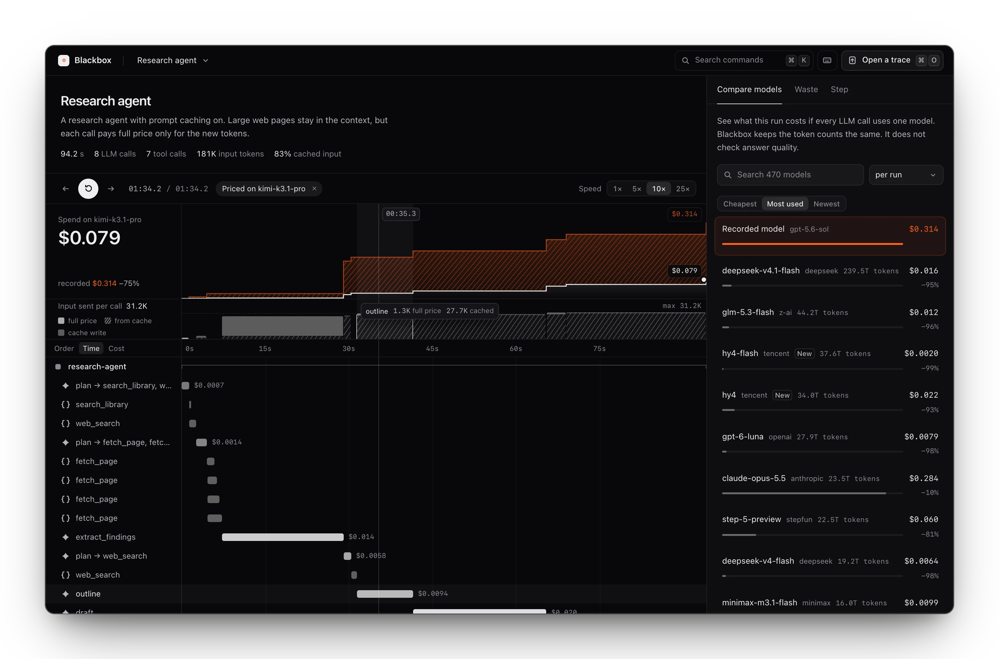
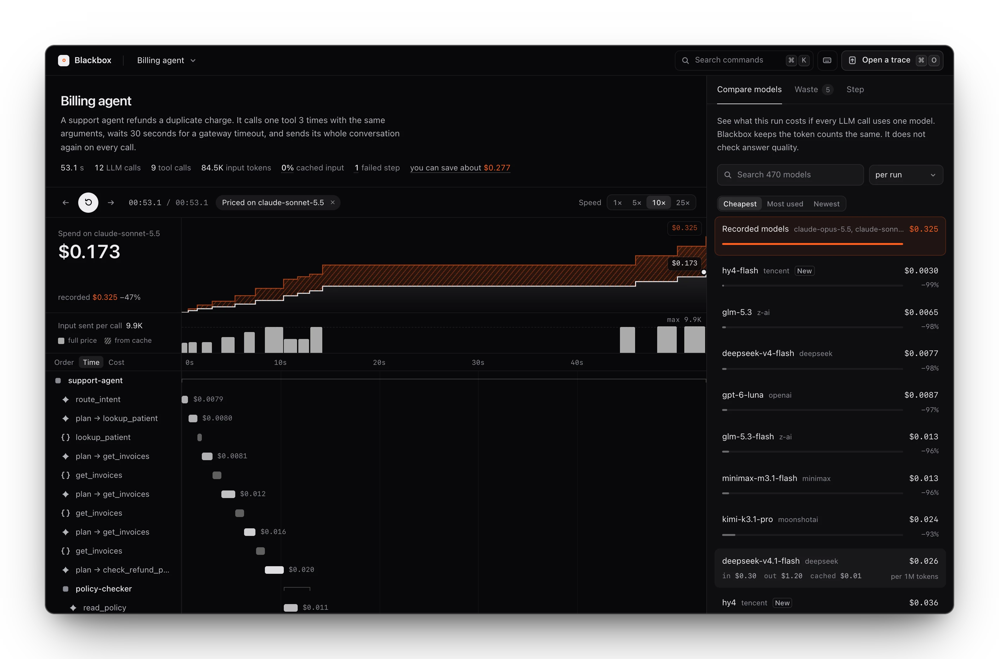
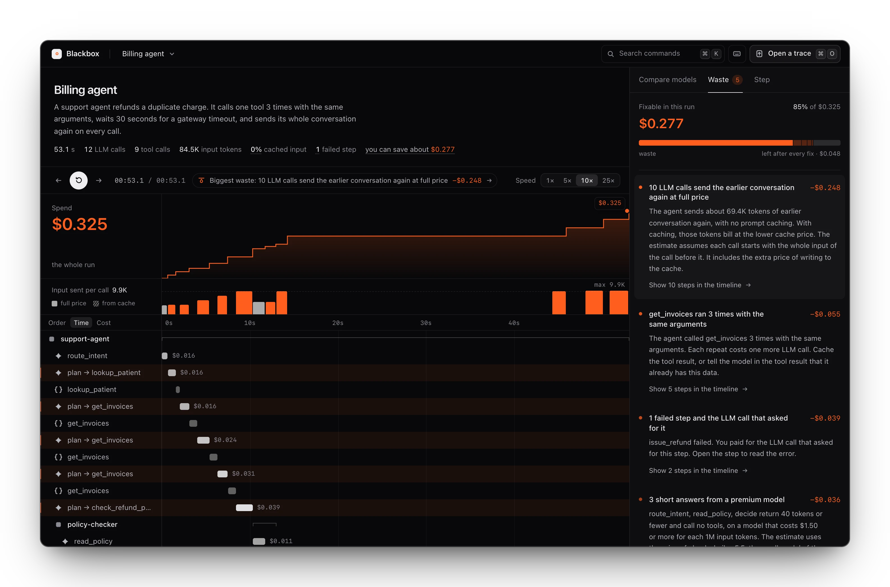
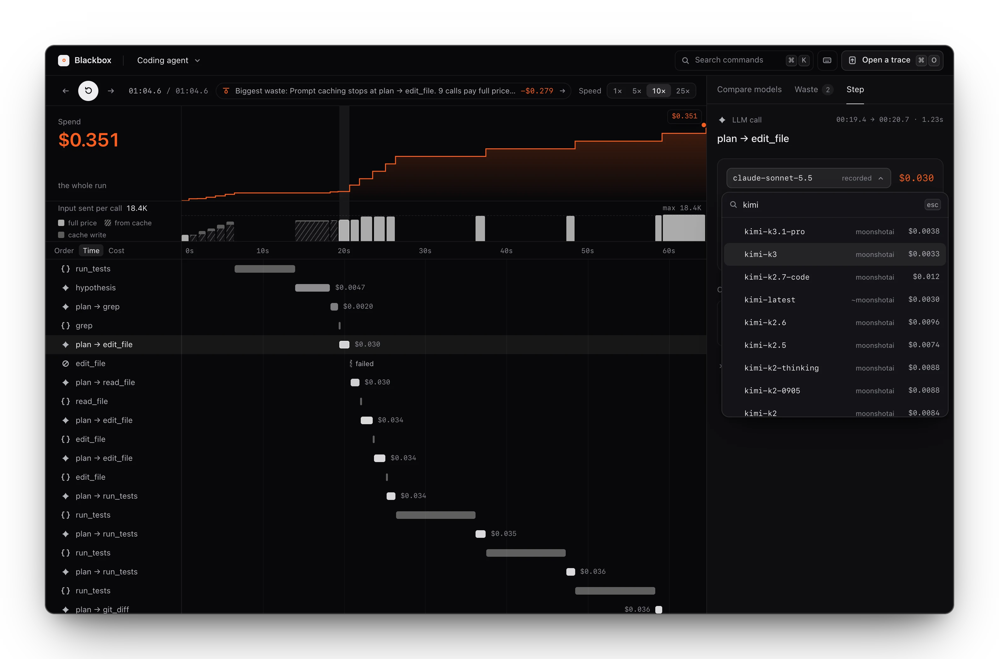
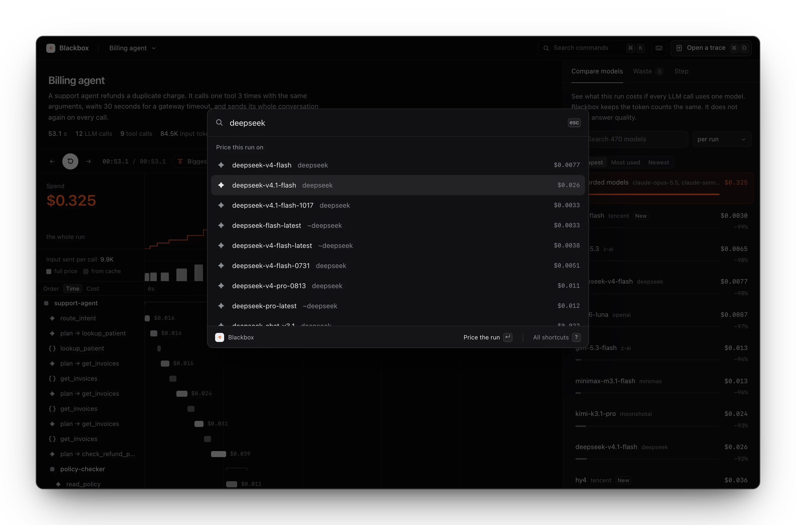

# Blackbox

A flight recorder for AI agents.

Drop in the trace of one agent run. Blackbox replays the run step by step, shows what each LLM call cost, finds the waste, and prices the whole run again on any OpenRouter model.

**Try it: [getblackbox.vercel.app](https://getblackbox.vercel.app)**. Open a demo run, or drop in a Claude Code or Codex session from your own disk.



Everything runs in your browser. Blackbox has no account and no upload. The server only refreshes the OpenRouter price list once an hour.

## What it shows

### The replay

A spend line climbs as the run plays. Under it, a bar for each LLM call shows the input that the call sent, split into full-price tokens and cached tokens. A timeline lists every step: agents, LLM calls, tool calls and retrievals. Point at a call to see its time and its input.

### Compare models

Pick a model, and Blackbox prices every LLM call on it. The spend line moves to the new cost, and the hatched band between the two lines is the money you save. The list shows the most used models on OpenRouter in the last 4 weeks. Sort it by price, by use or by release date, and point at a row to see its prices for each 1M tokens.



### Waste

Five checks look for money that a cheaper setup can save:

- earlier conversation sent again at full price, where prompt caching would bill it at the cache price;
- failed steps, and the LLM calls that asked for them;
- the same tool called 3 or more times with the same arguments;
- tool definitions that are more than 8% of the input on every call;
- a model that costs $1.50 or more for each 1M input tokens, on a call that returns 40 tokens or fewer and calls no tools.

Each finding names its steps and an estimated saving. Point at a finding, and its steps light up in the timeline and the input bars. The findings can overlap, so Blackbox combines them in sequence and never adds them up directly.



### One step

The input, output, cache and cost lines of one step, with its prompt and its result. Set a different model for this step only: search every OpenRouter model, see this step's cost on each, or type any model id. One click puts the step back on its recorded model.



## Honesty rules

- A re-priced cost keeps the recorded token counts. Another model can use more or fewer tokens, and Blackbox does not guess.
- Blackbox does not measure answer quality. A cheaper model can give worse answers.
- If a model has no price, the step keeps its recorded cost. The UI says so.

## Trace formats

Blackbox finds the format from the file content, not the file name. To find these files on your disk, or to make one, read [Open your agent's runs in Blackbox](docs/opening-traces.md).

| Format | What it reads |
| --- | --- |
| Claude Code session | `~/.claude/projects/<project>/<session>.jsonl`, with its `subagents/` files if you open them together |
| Codex session | `~/.codex/sessions/<year>/<month>/<day>/rollout-*.jsonl` |
| OpenTelemetry JSON | Spans with GenAI (`gen_ai.*`) or OpenInference (`llm.*`) attributes |
| Chat lines | JSON lines of OpenAI or OpenRouter chat completion requests and responses |
| Blackbox JSON | The native format. See `lib/types.ts` and `data/traces/` |

The limit is 250 MB. Times can be in seconds or milliseconds. Blackbox moves every trace so that it starts at zero. In a Claude Code or Codex session, the time that the session waits for your next message is taken out, and the run says how much.

## Keyboard

Press `?` in a replay to see every shortcut. Press `⌘K` to open the command menu. The most used keys:



| Key | Action |
| --- | --- |
| `Space` | Play or pause |
| `←` `→` | Previous or next LLM call |
| `J` `K` | Next or previous step |
| `1` `2` `3` | Compare models, Waste, Step |
| `/` | Search models |
| `⌘O` | Open a trace |

## Run it on your computer

You need [Bun](https://bun.sh) 1.4 or later.

```bash
bun install
```

```bash
bun dev
```

Then open http://localhost:3000.

Other commands:

```bash
bun run build
```

```bash
bun test
```

```bash
bun run lint
```

The Compare list features the most used models on OpenRouter. The server reads them with an OpenRouter API key. Put the key in `.env.local` as `OPENROUTER_API_KEY`. To refresh the saved copy that the site uses without a key, run this command:

```bash
bun scripts/featured.ts
```

To write the demo traces again, run this command. It writes the files in `data/traces/`.

```bash
bun scripts/demos.ts
```

## How the code is set up

| Path | What it holds |
| --- | --- |
| `app/` | The landing page, the demo pages (`/demo/[slug]`) and the page for a trace you open (`/trace`) |
| `components/Workbench.tsx` | The replay: state, playback and the keyboard map |
| `components/Recorder.tsx` | The spend line, the input bars and the step timeline |
| `components/Panel.tsx` | The side panel: Compare models, Waste and Step |
| `components/Commands.tsx` | The command menu, the shortcut sheet and tooltips |
| `components/Popover.tsx` | The select and the model picker |
| `lib/adapters.ts` | The trace parsers and the trace clean-up |
| `lib/cost.ts` | Prices and cost math |
| `lib/findings.ts` | The five waste checks |
| `lib/models.ts` | The OpenRouter model list, cached for one hour, with a saved copy as a fallback |
| `lib/featured.ts` | The models the Compare list shows first, from OpenRouter usage rankings, with a saved copy as a fallback |

Built with Next.js 16, React 19, Tailwind CSS 4 and Motion.

## Author

Built by Srijit Ghosh.
