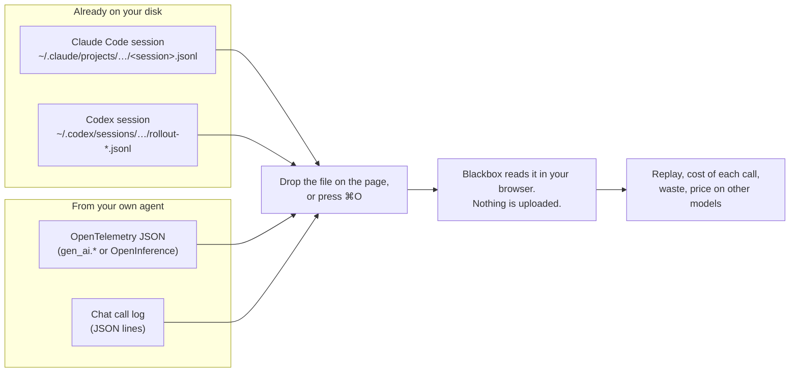

# Open your agent's runs in Blackbox

Blackbox opens one file that records one agent run. This guide shows where those files already are, and how to make one when you do not have one yet.



The quickest way in: if you use Claude Code or Codex, the files are already on your disk. Open one and see your own run in a few seconds.

## Claude Code

Claude Code saves every session as one JSON lines file:

```
~/.claude/projects/<project folder>/<session id>.jsonl
```

The project folder is the full path of the project, with each `/`, `.` and `_` written as `-`. For example, the sessions for `/Users/you/code/shop` are in `~/.claude/projects/-Users-you-code-shop/`.

To find your newest session in any project, run this command. It prints the path of the file.

```bash
ls -t ~/.claude/projects/*/*.jsonl | head -1
```

To list the sessions of one project, newest first:

```bash
ls -t ~/.claude/projects/-Users-you-code-shop/*.jsonl
```

**Sub-agents.** When a session starts sub-agents, each one writes its own file in a `subagents` folder next to the session file:

```
~/.claude/projects/<project folder>/<session id>/subagents/agent-*.jsonl
```

Select the session file and its sub-agent files together, and open them as one. Each sub-agent shows as its own agent under the session.

**How long the files stay.** Claude Code deletes old sessions after `cleanupPeriodDays`, which is 30 days by default. Copy a session that you want to keep.

**What Blackbox reads.** Each API call with its input, output, cache read and cache write tokens, each tool call with its own time and result, and the model of each call. One API call takes many lines in the file, and Blackbox counts its usage once.

**What Blackbox changes.** Time while the session waits for your next message is taken out of the timeline, so a session of two days shows its real agent time. The run says how much idle time it removed. Tool and model time are as recorded.

**What the file does not have.** Claude Code also makes small background requests, for example for session titles. They are not in the session file, so the cost in Blackbox can be a little lower than your bill.

## Codex CLI

Codex saves every session as one JSON lines file, in folders by date:

```
~/.codex/sessions/<year>/<month>/<day>/rollout-<time>-<id>.jsonl
```

To find your newest session:

```bash
ls -t ~/.codex/sessions/*/*/*/rollout-*.jsonl | head -1
```

Blackbox reads the older and the newer Codex formats. Each model response becomes one LLM call with its tokens. Cached tokens are counted apart from new ones. Each tool call pairs with its output and its exit code. The title of the run is your first request.

Some Codex files hold history that was imported from another session. They have no token counts, so Blackbox shows no calls for them.

## Open the file

- Drag the file onto any Blackbox page, or press `⌘O` and choose it.
- The `.claude` and `.codex` folders are hidden. In the macOS file dialog, press `⌘⇧.` to show hidden folders, or press `⌘⇧G` and paste the folder path.
- To open a session with its sub-agents, select all the files, then drag them together.
- The limit is 250 MB.

The file stays in your browser. Blackbox does not send it to a server and does not store it, except in your browser tab, so that a reload shows the same run.

## From your own agent

### OpenTelemetry JSON

Blackbox reads OTLP JSON (`{ "resourceSpans": [...] }`), one document or one per line. It reads the GenAI conventions (`gen_ai.usage.input_tokens`, `gen_ai.request.model`, `gen_ai.tool.name`, …) and the OpenInference names (`llm.token_count.prompt`, `llm.model_name`, …).

Places that make this format:

- **Your own exporter.** Add an OTLP file exporter, or a collector with a file exporter, to an agent that already emits GenAI spans.
- **The Vercel AI SDK.** Its telemetry emits GenAI spans with token counts and messages.
- **Arize Phoenix.** Download a trace as OTLP JSON from the Phoenix UI.
- **OpenRouter Broadcast.** OpenRouter can send each new request as OTLP JSON to an OpenTelemetry collector or a webhook. Send the same `session_id` with every request of one run, then put the spans of that session in one file. Broadcast sends new requests only, not history.

### Chat call log

If your agent calls the OpenAI or OpenRouter chat API directly, write one line for each call:

```json
{ "model": "anthropic/claude-sonnet-5.5", "messages": [...], "tools": [...], "response": { "usage": {...}, "choices": [...] }, "start": 1795000000000, "duration_ms": 1840 }
```

`start` is the start of the call in milliseconds, and `duration_ms` is how long it took. A line that is only the response object (`{ "model", "usage", "choices" }`) also works.
